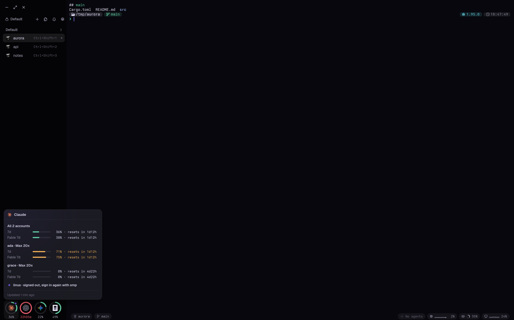
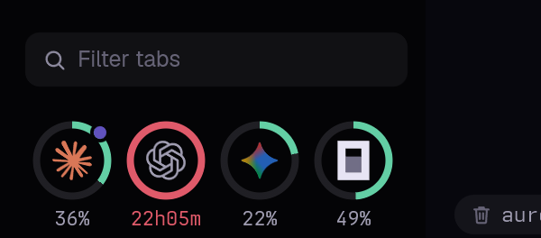
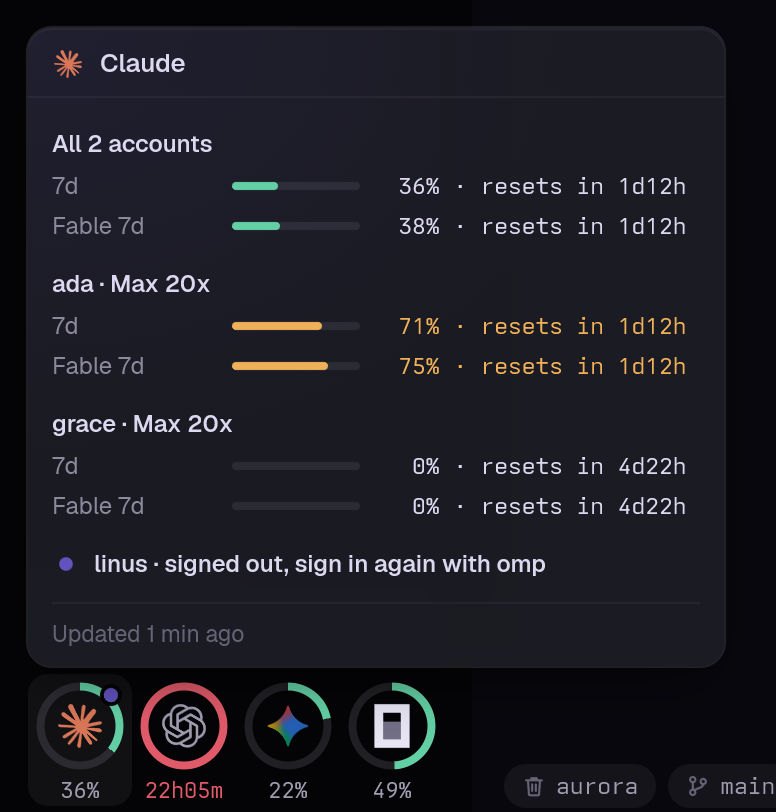
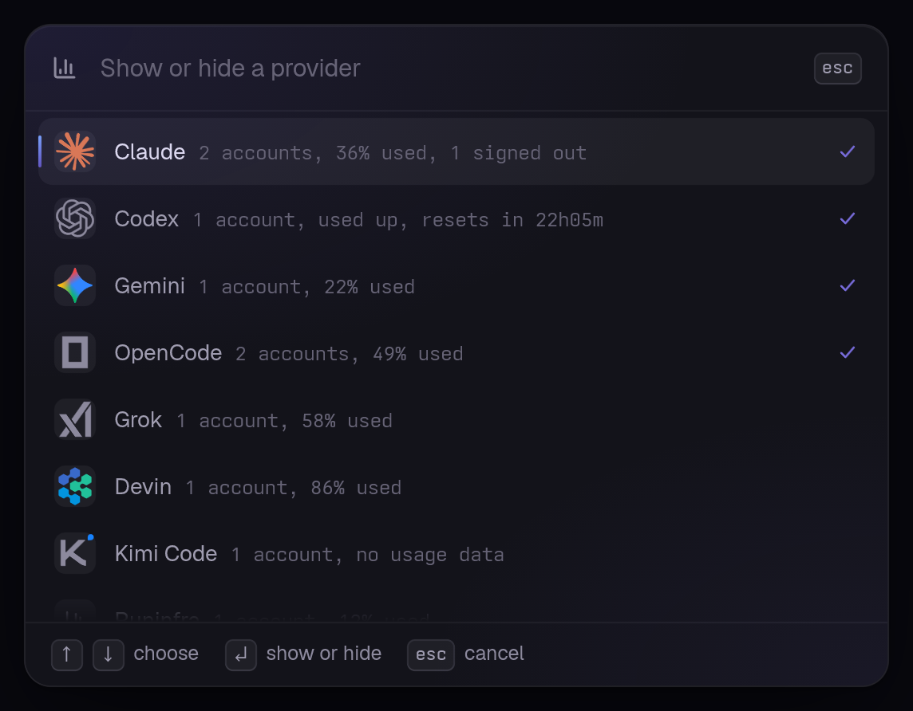
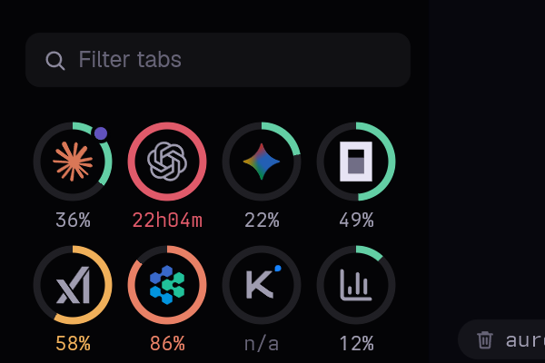

# Usage Rings

A [Tern](https://docs.stencil.so/tern/) plugin that shows how much of each AI coding subscription you have used. Every provider gets a ring at the foot of the tab column. Hover a ring to see each account behind it.



The accounts in these screenshots are made up.

## What you see



The ring fills as the provider's accounts get used. It measures the pool, which is all of your accounts for that provider counted together, in whichever limit window is closest to running out. The number under the ring is the same figure.

The colour follows the fill.

| Used | Colour |
| --- | --- |
| Below 50% | Green |
| 50% to 79% | Amber |
| 80% to 94% | Orange |
| 95% and above | Red |

When a pool is used up, the number becomes the time until it resets. `22h05m` under a full red ring means the provider is back in 22 hours and 5 minutes.

A purple dot on a ring means omp can no longer use one of that provider's accounts, usually because its sign-in expired. Sign in again with omp and the dot goes away.

## The card



Hover a ring to open its card. Click the ring to keep the card open until you click somewhere else.

The card lists the pool first, then each account with its plan. Every limit has a meter, the share used and the time until it resets. A limit turns amber, orange or red at the same thresholds as the ring. The last line says how old the figures are.

## Install

Usage Rings needs Tern with omp, the agent Tern ships with. It reads `omp usage --json`, so it shows whichever accounts omp is signed in to. It works on Tern 0.9.26.

```sh
tern plugin install github.com/WyrmKeep/tern-usage-rings
```

The repository is private, so git has to be able to clone it. Run `gh auth setup-git` once, or install over SSH instead.

```sh
tern plugin install git@github.com:WyrmKeep/tern-usage-rings.git
```

A fresh install shows no rings. Choose the providers you want next.

## Choose providers

Open the command palette and run "Choose usage providers".



Each row is a provider, with its account count and usage. Press Enter to show or hide the selected provider. The picker stays open so you can change several, and Esc closes it.

Claude, Codex, Gemini, OpenCode and Grok are always in the list. Any other provider omp reports, such as Devin or Kimi Code, appears under its own name.

The dock holds four rings in a row and adds a row when you show more.



The rings are ordinary Tern widgets named `usage-rings/<provider>`. You can also add, remove and reorder them in Tern's widget editor. The dock follows the order they have in the widget bar.

## Where the rings go

The rings sit in a dock under the tab filter when your tabs run down the side of the window.

If the side tabs are set to hide themselves, there is no column to dock in. The rings move to the right end of the band at the top of the window.

With tabs along the top, the rings stay in the widget bar at a smaller size.

## How it works

`window.luau` runs `omp usage --json` every five minutes. It keeps the last answer in the plugin's key-value store, which all Tern windows share. A new window shows that answer at once, and only one window asks omp per interval.

omp's live report sometimes leaves a provider out. For those providers the plugin reads the latest figures from `omp usage --history --json -d 1` and says so on the card.

`lib/model.luau` turns omp's JSON into one state per ring. A state holds the text under the ring, the lines of the card and the fill of every meter. This file does no I/O.

The pool comes from omp's own `capacity` figures when the report has them. Otherwise it is the mean use across the accounts that have that limit. A limit that covers one model tier, such as Claude's Fable limit, appears on the card but does not move the ring unless it is the only limit the account has.

Tern's widgets and hover cards carry no class per row, so a stylesheet cannot tell one meter from another. `lib/sheet.luau` solves that by writing a small sheet of custom properties, addressed by widget name and row number, and installing it with `tern.css`. `usage-rings.css` reads those properties and does all the drawing.

The dock relies on the names Tern gives its own elements, such as `#sidebar` and `#widgetbar`. A Tern update that renames them will need a matching change here.

## Develop

Link the checkout so Tern loads it in place. Tern reloads the plugin when a file changes.

```sh
tern plugin link .
```

Two environment variables make the plugin read files instead of running omp. The clock then stands still at the file's `generatedAt`, so the reset times on screen do not move.

```sh
omp usage --json --redact > usage.json
USAGE_RINGS_FIXTURE=$PWD/usage.json tern
```

Tern has to start with the variable set, so quit a running Tern first. `USAGE_RINGS_HISTORY_FIXTURE` does the same for the history file.

`tern plugin types .` writes `tern.d.luau` for luau-lsp. Git ignores that file.

## Limits

- The figures refresh every five minutes. There is no manual refresh.
- The dock has room for sixteen rings, in four rows.
- omp decides which accounts exist. The plugin cannot add or sign in to one.

## Remove

```sh
tern plugin remove usage-rings
```

The rings leave the window with the plugin.
